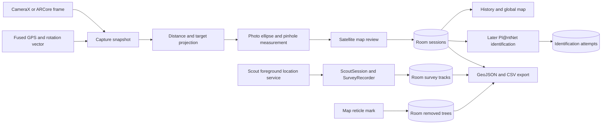

# SpatialMapper

An Android app for locating, measuring, and identifying individual trees and vegetation that are
missing from — or wrong in — outdated satellite imagery. The operator stands at a distance, points
the phone at a tree, and takes one photo. That capture yields a projected tree coordinate and an
approximate canopy diameter from the phone's camera, GPS, and orientation sensors. A separate close-up
can be submitted later for species identification. There is no survey equipment, no ground control,
and — deliberately — no dependency on Street View, Visual Positioning Service, or any other
coverage-limited backend, so it works anywhere a phone can get a GPS fix.

Built as an academic / portfolio project. Kotlin, Jetpack Compose, minSdk 34.

---

## Features

- **Single-photo capture with synchronized telemetry.** Each shot records GPS position and accuracy,
  compass heading (corrected to true north via `GeomagneticField` declination), device pitch, and the
  camera's focal length and frame dimensions, all sampled at the moment the shutter fires.
- **Distance measurement with a graceful fallback.** Uses the **ARCore Depth API** where the device
  supports it, reading metric depth at the center of the frame. On devices without ARCore or without
  Depth, it falls back to flat-ground trigonometry (`distance = eye height / tan(depression angle)`)
  derived from device pitch. The device's capability is probed once when the camera opens, and which
  method produced a given measurement is stored with the record.
- **Geodesic projection to a real coordinate.** Origin + true-north bearing + distance are projected
  using `SphericalUtil`'s Earth-sphere model to get the target's latitude and longitude, with a
  round-trip consistency check that catches unit and lat/lon-order mistakes.
- **Satellite map review with operator-editable canopy framing.** After capture, the operator drags
  an ellipse over the tree crown in the photo; that pixel geometry is converted to metres through the
  pinhole model and the measured distance. The resulting polygon is then shown on a satellite map,
  where the operator can nudge the position before saving. What gets stored is the polygon the
  operator confirmed — not a shape regenerated later from a centre and radius.
- **Species identification via Pl@ntNet.** Decoupled from capture and available on demand from any
  saved record: shoot a close-up of a leaf, flower, fruit, or bark, submit it to the Pl@ntNet API
  against the Indian Subcontinent flora, and pick from ranked candidates. Every attempt is preserved,
  including the ones you reject or skip.
- **Session history with a full audit trail.** Every saved record keeps its photo, raw telemetry,
  which distance method was used, the confirmed canopy polygon, and the complete identification
  history — so a number on screen can always be traced back to how it was produced.
- **Global map and Scout.** Saved crowns appear as polygons on the satellite map. Scout shows the
  operator's current position and a thinned walking trail; a location foreground service keeps it
  running while the screen is locked. A walk can be deliberately recorded, saved, listed in History,
  and opened as a map overlay.
- **Removed-tree observations.** Mark a tree visible in the imagery but absent on the ground without
  fabricating a capture session. The mark stores its map position, timestamp, and, when available,
  the operator's position, GPS accuracy, and distance from the mark.
- **GIS export.** Export captured crowns, removed-tree marks, and survey tracks together as GeoJSON;
  export captured sessions and removed trees as separate CSV files.

## Screenshots


*Session detail — the captured photo alongside a confirmed Pl@ntNet species identification.*


*The full raw-sensor audit trail kept alongside the confirmed measurement.*

Every session retains both records shown above: the raw sensor-derived telemetry — GPS, heading,
pitch, and which distance method was used, exactly as captured — and the operator-corrected result it
produced. Neither overwrites the other, so any figure shown elsewhere in the app can always be traced
back to the reading it came from.


*The confirmed canopy footprint over satellite imagery, at its projected coordinate.*

## How it works

The capture pipeline is a linear sequence of five steps, with the operator confirming the result at
each stage where a machine estimate could plausibly be wrong.

```
  Telemetry capture  ->  Distance  ->  Projection  ->  Canopy framing  ->  Map review  ->  Save
   photo + GPS +        ARCore depth   geodesic       drag an ellipse     confirm on      Room
   heading + pitch      or ground-     offset along   over the crown,     satellite
   + intrinsics         plane geometry true-north     px -> metres        imagery
                                       bearing
```

1. **Telemetry capture.** CameraX takes the photo; the fused location provider supplies position and
   accuracy; the rotation-vector sensor supplies azimuth and pitch. Azimuth is corrected from magnetic
   to true north, and sensor accuracy is recorded alongside it so a low-confidence compass reading is
   visible later rather than silently trusted. Camera intrinsics (focal length in pixels, frame size)
   are read from Camera2 characteristics for the pixel-to-metre conversion downstream.

2. **Distance.** ARCore Depth is queried at the center pixel, which corresponds to the on-screen
   crosshair, so no view-to-sensor mapping is needed. Without Depth, the ground-plane fallback assumes
   the tree's base sits on level ground at the camera's own footing and solves for horizontal distance
   from the depression angle. That assumption degrades on slopes; the fallback declines to answer at
   all near the horizon, where the estimate diverges.

3. **Projection.** `origin + bearing + distance` is offset along a great circle to produce the
   target's coordinate. The bearing is degrees clockwise from true north when a GPS fix allows a
   declination correction; otherwise the sensor stack flags it as magnetic. The projection uses the
   reported heading as received.

4. **Canopy framing.** Rather than segmenting the crown automatically, the operator drags an ellipse
   over the tree in the captured photo. Its horizontal and vertical extents are converted to metres
   through the pinhole relation `metres = pixels x distance / focalLengthPixels`. This is a
   deliberate choice: an operator who can see the tree resolves crown boundaries in cluttered foliage
   far more reliably than an on-device model, and — unlike a model's output — the result is
   inspectable at the moment it is produced.

5. **Map review and save.** The framed crown is drawn as a polygon on satellite imagery, positioned at
   the projected coordinate. The operator can nudge it against visible landmarks before committing.
   The confirmed vertex list is what persists to the database, and it is what every later screen draws.

**Species identification runs outside this pipeline entirely.** A tree can be located and measured on
one visit and identified days later, from the record's detail screen — the close-up capture attaches
to the existing record and adds no new telemetry. Submissions append to an
`identification_attempts` table; the record's species columns hold only the most recently confirmed
answer, so a wrong confirmation can be revisited without the earlier evidence having been destroyed.

## Architecture and data flow



The single `MainActivity` switches among Capture, History, and Map through an `AppTab` enum. It
hoists framing, review, selected-record, map-focus, and identification state so tab changes preserve
the active flow. Framing, map review, and identification use one `inModalFlow` flag to hide the tab
bar. There is no navigation graph or requirement to parcel the in-process telemetry types.

The capture path has two camera implementations. An ARCore capability probe selects an AR frame and
Depth API path when available. Otherwise CameraX captures the JPEG and Camera2 supplies a focal
length estimate. `TelemetryTracker` samples fused location and the rotation-vector sensor; its
snapshot joins those readings to the selected distance method and computes the raw target coordinate.
The framing screen measures the photo; the map review screen lets the operator translate or resize
the generated footprint before `SessionRepository` inserts a `SessionEntity`.

Room schema **v6** has four tables:

| Table | Contents | Relationship |
| --- | --- | --- |
| `sessions` | One confirmed capture: JPEG path, origin and projected coordinate, sensor and camera readings, framed crown dimensions, final polygon, area, and current confirmed species. | Main plant record. |
| `identification_attempts` | Every submitted close-up, ranked candidates, and optional confirmed choice. | `sessionId` foreign key; deletion cascades from a session. |
| `removed_trees` | Imagery mark for a tree absent on site, with optional officer-location evidence. | Independent of captures. |
| `survey_tracks` | A completed walk with start/end time, point count, and timestamped positions. | Independent of captures. |

The JPEGs remain files referenced by path, not Room BLOBs. Survey points are serialized into one
track row; summary queries read the small metadata columns without loading the full geometry.
`SpatialMapperApplication` also backfills missing canopy areas for older sessions on a process-scoped
IO coroutine. Schema changes use additive migrations and exported schema snapshots; an unhandled
upgrade fails instead of deleting field records.

Scout has a separate lifecycle from Capture. `ScoutLocationService` requests fixes through a
location-typed foreground service, `ScoutSession` holds live state, and `ScoutTrail` filters and
thins the breadcrumb. A deliberately started survey uses the same accepted points. Ending the survey,
turning Scout off, or a normal service teardown funnels the recording through `SurveyRecorder` into
Room. A process kill before a survey is saved can still lose its in-memory points.

### Measurement and photogrammetric model

Symbols below refer to the implementations in `distance/`, `telemetry/`, `projection/`, `measure/`,
`map/`, and `area/`. Distances and crown sizes are estimates, not surveyed ground truth.

| Stage | Implemented relation | Notes |
| --- | --- | --- |
| Orientation | `heading = wrap360(azimuth + declination)`; `filtered = previous + 0.15 × shortestAngularDelta` | The rotation matrix is remapped for the portrait back-camera direction before azimuth is read. `GeomagneticField` supplies declination when a location fix exists; otherwise the heading remains magnetic and is flagged. Pitch is smoothed separately in its raw device frame. |
| AR depth | `range_m = DEPTH16_center_mm / 1000` | A zero depth or a frame without tracking yields no reading. The center pixel matches the capture reticle. The implementation passes this range directly to target projection and canopy scaling. |
| Ground-plane fallback | `depression = 90° − abs(pitch)`; `horizontal_distance = camera_height / tan(depression)` | The operator can edit camera height (default `1.5 m`). The model assumes level ground and a base at the camera footpoint's elevation; it returns no estimate at depression `≤ 1°` or `≥ 89°`. |
| Target projection | `target = computeOffset(origin, distance_m, heading_true_deg)` | Heading is clockwise from true north. `SphericalUtil` applies a great-circle offset; `computeDistanceBetween(origin, target)` provides a round-trip distance check. |
| Camera calibration | `f_px = f_mm × image_long_side_px / sensor_long_side_mm` on CameraX; ARCore uses `Frame.camera.imageIntrinsics` | Focal length and pixel span must describe the same saved image. AR JPEGs are rotated upright before framing; fallback intrinsics use the saved JPEG dimensions. |
| Photo-to-capture scale | `s = captured_long_side_px / displayed_long_side_px`; `span_x = round(2 r_x s)`, `span_y = round(2 r_y s)` | The draggable ellipse is drawn in displayed-photo pixels. Scaling its two diameters back to captured-image pixels avoids a display-size-dependent crown measurement. |
| Pinhole crown size | `D_x = span_x × range_m / f_px`, `D_y = span_y × range_m / f_px`; `D = (D_x + D_y) / 2` | Similar triangles, `span_px = f_px × D_m / range_m`. Both axis estimates and their mean are stored. Values outside `0.3–50 m` trigger a warning, not a save veto. |
| Crown footprint | `r = D / 2`; `vertex_i = computeOffset(center, r_i, 360° i / 24)` | Twenty-four radii receive seeded, smoothed jitter of at most `18%`, then are normalized to mean `r`. The map's center and radius handle may change the final outline. The confirmed vertices, rather than a regenerated shape, are saved. |
| Footprint area | `A = SphericalUtil.computeArea(confirmed_vertices)` | Computes unsigned spherical polygon area in square metres; fewer than three vertices mean area is unavailable. Hectares are `A / 10,000`. |

The image model assumes an approximately front-facing crown at the measured center range and ignores
lens distortion. The vertical photo extent is not necessarily a second ground-plane crown diameter;
for tall or flat crowns, averaging it with the horizontal extent can bias the footprint. The AR depth
value is used as the projection distance without a separate slant-range-to-horizontal correction.
GNSS error, compass error, sloped ground, depth quality, and the operator's framing can therefore move
or resize the result. Map review is the explicit correction step; the raw projected coordinate and
framed dimensions remain in the audit record.

### Survey geometry and export

Scout accepts a fix only when reported horizontal accuracy is positive and at most `20 m`. It keeps
the first point, then another only when it is at least `4 m` from the last kept point by spherical
ground distance; the live trail has a `10,000`-point cap. Its displayed walked length is the sum of
distances between kept points, so missed fixes and small detours can undercount the actual walk.

The GeoJSON `FeatureCollection` contains a Polygon per captured crown, a Point per removed-tree mark,
and a LineString per survey with at least two points. Records with unusable geometry are retained as
features with `geometry: null`. Export positions are `[longitude, latitude]`; polygon exterior rings
are closed and oriented counterclockwise for GeoJSON. The sessions CSV carries flat attributes, and
the removed-tree CSV carries its separate observation fields. Export uses the operator's document
picker and writes files only at the locations they choose.

## Tech stack

| Area | Choice | Notes |
| --- | --- | --- |
| Language / UI | Kotlin, Jetpack Compose, Material 3 | Single-activity. Navigation is a hand-rolled tab enum with hoisted screen state, not `navigation-compose` — the capture pipeline passes non-`Parcelable` telemetry types between steps in-process. |
| Camera | CameraX (`core`, `camera2`, `lifecycle`, `view`) | Two separate feeds: the measurement capture, and a close-up feed for identification with explicit tap-to-focus and `CAPTURE_MODE_MAXIMIZE_QUALITY`. |
| Depth / AR | ARCore Depth API (`com.google.ar:core`), SceneView | Declared **optional** in the manifest so the app installs and runs on non-ARCore devices. |
| Location | Google Play Services Fused Location | Position plus a real accuracy figure, which is stored rather than discarded. |
| Geodesy | `android-maps-utils` `SphericalUtil` | Great-circle offset, distance, and spherical polygon area. |
| Maps | Maps SDK for Android via `maps-compose` | Satellite imagery for review and the global map. Pinned to 8.2.0; 8.3.x requires `compileSdk 37`. |
| Persistence | Room 2.8.4 with KSP | Four tables: `sessions`, `identification_attempts`, `removed_trees`, and `survey_tracks`. Photos are stored as file paths, not BLOBs. |
| Field tracking | Fused Location, foreground location service | Scout's filtered live breadcrumb and deliberately saved survey walks. |
| Export | Android document picker, `org.json` | Mixed-geometry GeoJSON and separate sessions/removed-tree CSVs. |
| Species ID | Pl@ntNet v2 API, `k-indian-subcontinent` referential | Called over plain `HttpURLConnection` + `org.json`; no HTTP client library is used — see below. |
| Build | AGP 9.2.1 (built-in Kotlin 2.2.10), Gradle 9.4.1 | `compileSdk 36.1`, `targetSdk 36`, `minSdk 34`. |

The debug source set also contains a separate MapLibre/Sentinel-2 offline-basemap proof of concept.
It is launched by `MapLibrePocActivity`, depends on MapLibre only through `debugImplementation`, and
does not replace the Google Maps screens in the main app. Its MBTiles basemap is generated by
`tools/basemap/make_sentinel2_mbtiles.py` and copied onto a test device; MBTiles archives are not
committed.

### On the global-operability constraint

The obvious way to place a tree accurately is to ask Google's Visual Positioning Service, or to fit
the photo against Street View panoramas. Both were rejected up front: their coverage is dense in
cities and effectively absent in exactly the rural and peri-urban areas where satellite basemaps are
most stale — which is the whole reason this app exists. Everything in the measurement path therefore
runs on sensors the phone carries anyway. That costs accuracy relative to a VPS fix, and the app is
honest about it: GPS accuracy, compass reliability, and which distance method was used are all stored
and shown alongside the result.

The same constraint shapes the identification path in reverse. Pl@ntNet is a network call, so it is
deliberately not on the capture path — being offline in the field is expected, and identification is
a "whenever convenient" action that can happen later over any connection.

### On the absence of an HTTP library

The Pl@ntNet integration is one multipart POST and one JSON parse, written directly against
`HttpURLConnection`. Retrofit plus OkHttp plus a converter would add three artifacts to the
Kotlin-metadata compatibility surface — AGP 9's built-in Kotlin compiler reads class metadata only up
to 2.3.0, which already ruled out one dependency in this project — plus R8 keep rules for the
response models, to replace about 150 lines. The response parser is a pure function with no Android
dependencies, unit-tested against a recorded response body.

## Setup

### Prerequisites

- An Android Studio version new enough to support **AGP 9.2.1**, with the Android SDK for **API 36**
- **JDK 21** — `gradle/gradle-daemon-jvm.properties` pins the daemon toolchain to 21 and Gradle will
  auto-provision it if it is not already installed
- An **arm64-v8a** physical device running **Android 14 (API 34)** or newer

### 1. Clone

```bash
git clone https://github.com/glitching-gops/beaver.git
cd beaver
```

### 2. Configure API keys

Both keys go in `local.properties`, which is git-ignored and must stay that way. The project ships a
committed `local.defaults.properties` holding only placeholders, so it **configures and builds
without any key at all** — the map renders blank tiles and identification reports that no key is
configured, but nothing crashes. The Secrets Gradle Plugin reads `local.properties` first and falls
back to that file.

**Google Maps SDK for Android**

1. Open the [Google Cloud Console](https://console.cloud.google.com/) and create (or select) a
   project.
2. Enable **Maps SDK for Android** under *APIs & Services → Library*.
3. *APIs & Services → Credentials → Create credentials → API key*.
4. Restrict the key — *Application restrictions → Android apps*, adding package name
   `com.gops.spatialmapper` with your debug keystore's SHA-1 (`./gradlew signingReport`), and
   *API restrictions → Maps SDK for Android*. An unrestricted key in a public repo's setup path is
   the classic way to get one abused.

**Pl@ntNet**

1. Sign up at [my.plantnet.org](https://my.plantnet.org/) (free).
2. Go to the **API** tab in your account and generate a key. The free tier allows **500
   identifications per day**.

**Put them in `local.properties`** (create the file if Android Studio has not already):

```properties
sdk.dir=/path/to/your/Android/Sdk
MAPS_API_KEY=AIza...your-maps-key
PLANTNET_API_KEY=2b10...your-plantnet-key
```

Never edit `local.defaults.properties` to hold a real key — it is committed.

The Maps key reaches the app as a manifest placeholder; the Pl@ntNet key is read from Kotlin as
`BuildConfig.PLANTNET_API_KEY`, which is why `buildFeatures { buildConfig = true }` is set in
`app/build.gradle.kts`. Without that flag the generated constant silently does not exist.

### 3. Build and run

```bash
./gradlew assembleDebug        # build
./gradlew installDebug         # install to a connected device
./gradlew testDebugUnitTest    # run the unit tests
```

Or open the project in Android Studio and run the `app` configuration.

**arm64-v8a only.** `app/build.gradle.kts` sets `abiFilters += "arm64-v8a"`, so debug builds **will
not install on the standard x86_64 emulator** — if `installDebug` fails with an ABI/INSTALL_FAILED
error, that's why, not a broken build. Only a physical arm64 device (or an arm64 emulator image, which
most default AVDs are not) will accept the APK. This is intentional — the measurement path needs a
real camera, compass, and GPS, none of which an emulator provides meaningfully. Add `"x86_64"` to
that list if you want to run the non-sensor screens (history, maps, identification) on an emulator.

### 4. Permissions

Camera and precise location are requested at runtime on first launch. Internet and network-state are
install-time permissions and need no prompt. Both keys are optional for the app to *start*: without
Maps you get blank tiles, without Pl@ntNet you get an explicit "no key configured" message on the
identification screen.

## Current status

The implemented flows cover capture with synchronized telemetry, ARCore-or-fallback distance,
projection, photo framing, satellite map review, Room history and deletion, later species
identification with attempt history, Scout navigation and saved surveys, removed-tree marks, canopy
area, and GeoJSON/CSV export. Unit and instrumented tests cover the pure geometry, export and
identification logic, image rotation, area backfill, and Room migrations.

Measurement accuracy has not yet been validated against ground truth, so distance, target position,
canopy diameter, and area remain approximate. The pitch-to-depression convention and AR depth's use
as a horizontal projection distance need checks against measured targets on real devices. Sloped
ground, device-specific sensor/camera behavior, and interrupted survey recording also need field
validation.

## License

MIT. See [LICENSE](LICENSE).
